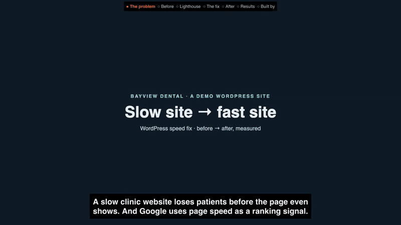

# WordPress speed fix: before and after

This is a slow WordPress site for **Bayview Dental**, a fictional clinic in Davao City. It is built the way real client sites end up slow. One script, `fix.sh`, fixes it, and Lighthouse measures the site before and after. Everything runs locally in Docker and is driven only by WP-CLI and the shell.

**What this proves:** one shell script (`fix.sh`, WP-CLI only) takes a bloated Elementor site from a 26 MB page to about 1 MB and the main image on a slow phone from about 104 s to under 5 s. `./check.sh` then checks with Lighthouse and screenshots that the speed went up and the page still looks the same.

[](demo/p4-demo.mp4)

16-second preview at 5x speed. Click it for the full 89-second narrated demo (`demo/p4-demo.mp4`).

**Live case study:** https://mckenneth.vercel.app/case-studies/wp-speed-fix/

**`./check.sh`, run again on 16 Oct 2026** (reset to the slow snapshot, then measure, fix, measure again; real output, shortened):

```text
[measure] before median: {"score":53,"lcp_ms":111547,"total_bytes":25996091,"requests":66}
[fix] 1/6 plugins … 6/6 database
[measure] after median:  {"score":78,"lcp_ms":4868,"total_bytes":1056857,"requests":55}
PASS  score +25 ≥ +15
PASS  page weight 4.1% of before ≤ 40%
PASS  LCP 4868 ms < 111547 ms
PASS  1280px: 17/17 section headings visible
PASS  1280px: pixel diff 0.054% (3416 of 6316800 px) ≤ 1%
PASS  375px: 17/17 section headings visible
PASS  375px: pixel diff 0.074% (2516 of 3411750 px) ≤ 1%
```

The first run of this check failed the 1280px pixel diff (1.84%). Another heavy check was running on the same machine, and two 3 MB photos had not painted yet in the *before* screenshot. Re-taking the before screenshot with the machine idle gave the PASS lines above.

**Caveat:** Bayview Dental is a fictional clinic and this is a demo site, not client work. It is measured on localhost with Lighthouse's simulated slow 4G, so a real host adds its own delay (see Honest notes).

## Results

Lighthouse 13.5.0, mobile, simulated slow 4G, median of 3 runs (`results/before.json`, `results/after.json`):

| Metric | Before | After |
|---|---:|---:|
| Lighthouse performance score | 55 | 78 |
| Largest Contentful Paint | 104.0 s | 4.9 s |
| First Contentful Paint | 6.2 s | 2.6 s |
| Speed Index | 18.5 s | 2.6 s |
| Total Blocking Time | 21 ms | 0 ms |
| Cumulative Layout Shift | 0 | 0.011 |
| Page weight | 26.0 MB | 1.1 MB |
| Requests | 66 | 55 |

In plain words: on a slow phone connection the main picture showed after 104 seconds before the fix and after 4.9 seconds after it, and the page is 96% lighter. Every visible heading is still there and full-page screenshots differ by under 0.1% (`verify.mjs`). `report.html` is the one-page before/after report.

## Run it

Needs Docker, Node 22, Google Chrome (set `CHROME_PATH` if it is not at the macOS default), ImageMagick 7 (`magick`) and `cwebp`. The screenshot checks need Playwright:

```bash
npm i -D playwright && npx playwright install chromium   # or point PLAYWRIGHT_PATH at an existing install
```

Then:

```bash
assets/fetch-photos.sh   # 12 Wikimedia Commons photos → assets/photos (gitignored), see assets/CREDITS.md
./seed.sh                # docker compose up + builds the slow site on http://localhost:8091 (admin/admin) + snapshot
./check.sh               # reset → shoot → measure → fix.sh → measure → shoot → assert (about 4–9 minutes)
node render-report.mjs   # report.html from results/before.json + results/after.json
./reset.sh               # back to the slow snapshot, byte for byte
```

`./fix.sh` on its own applies the fix to whatever is running on :8091. The stack runs as compose project `va-p4`: MariaDB 11, `wordpress:php8.3-apache` and `wordpress:cli-php8.3`; `./wp …` runs WP-CLI inside it. Measuring uses `npx -y lighthouse@13.5.0`, so no install is needed for it.

## What makes it slow

All of these are common on real sites. Nothing is faked: no `sleep()` and no artificial delays.

| Cause | Where |
|---|---|
| Elementor one-page home: background-slideshow hero, services, about, team, reviews, gallery and a contact form | `php/build-home.php` |
| 12 camera-size JPEGs (3200 px, 0.9–3.1 MB, 24 MB in total) used at full size | `assets/fetch-photos.sh`, `seed.sh` |
| Three snippets an inherited site often carries: native lazy-loading off, no smaller image sizes (so no `srcset`), no big-image scaling | `php/legacy-snippets.php` (mu-plugin) |
| Elementor's "Optimized image loading" and "Lazy load background images" switched off | `seed.sh` |
| Three Google Font families (Poppins, Open Sans, Lora), with every weight requested from fonts.googleapis.com | Elementor kit + widgets |
| No page cache, no gzip, no Expires headers. Apache has the modules but no rules turn them on | `docker-compose.yml` |
| Database clutter: 362 revisions, 603 expired transients, 250 spam comments | `php/bloat.php` |

**Plugins on the slow site:**

| Plugin | Front-end assets on the home page |
|---|---|
| Elementor | frontend CSS/JS, per-widget CSS, Swiper, jQuery UI core |
| Essential Addons for Elementor Lite | `general.min.css` + `general.min.js`, loaded even though no EA widget is used |
| Contact Form 7 | CSS + JS + `swv`, plus Astra's CF7 CSS (the form *is* used on the home page) |
| Font Awesome (official) | `all.css` + `v4-shims.css` from use.fontawesome.com, plus a local `svg-with-js.css`. Unused, because Elementor ships its own icons |
| Smash Balloon Instagram Feed | 3 stylesheets on every page, with no feed anywhere |
| Smart Slider 3 | none. Installed and active, used on no page |
| WPForms Lite | none. Installed and active, used on no page |

## What fix.sh does

1. **Plugins.** It deletes Smart Slider 3, WPForms Lite and Font Awesome. The `bayview-speed.php` mu-plugin then loads Instagram Feed and CF7 assets only on pages that contain their shortcode.
2. **Images.** It removes the legacy snippets and turns Elementor's image-loading optimisation back on. Each JPEG becomes a WebP (`magick` resize to 1920 px max, then `cwebp -q 78`), and `wp search-replace` swaps the URLs. `wp media regenerate` creates real `srcset` sizes. The hero's slide 1 is preloaded with `fetchpriority="high"` and painted in CSS before the slideshow JS runs, and slides 2–3 are lazy-loaded.
3. **Caching.** It adds the free Cache Enabler plugin for page caching. `.htaccess` gets gzip (`mod_deflate`) and `Expires` rules (`mod_expires`).
4. **Fonts.** Elementor's "Load Google Fonts locally" setting serves the fonts from the site itself, with `font-display: swap`. The emoji script is removed.
5. **JavaScript.** Every script gets WordPress's `defer` strategy. WordPress itself keeps a script blocking when inline code needs it, which is how the jQuery-based slideshow keeps working.
6. **Database.** It deletes revisions, expired transients and spam, then runs `wp db optimize`.

## Check thresholds

`check.sh` exits with a non-zero code when any of these fail (`verify.mjs`):

- **Score gain ≥ +15 Lighthouse points.** The plan asked for +25. Across real runs the gain was +22 to +25, and the final configuration gave +23 on both runs (55 → 78). The slow site scores 47–55 rather than ~20, because its 24 MB of images wreck LCP but not TBT or CLS, which make up 55% of the score. So +25 failed on honest runs. The line is set at +15: the before score depends on live CDNs (Google Fonts, Font Awesome) and host load, so a tighter line would fail on noise, not on a regression. The weight and LCP checks below carry the rest.
- **Page weight after ≤ 40% of before.** Real result: about 4%.
- **LCP after < LCP before.**
- **Every visible h1/h2/h3 from the before page is still visible after**, at both 1280 and 375 px.
- **Full-page pixel diff ≤ 1.0%** (`magick compare -metric AE -fuzz 10%`, hero slideshow frozen on slide 1). Before vs after measured 0.05–0.07%, from WebP re-encoding and resampling. A layout shift or a missing section shows up as several percent, and a change in page height fails the check outright.

Tested versions (seed.sh and fix.sh install latest; pin these with `--version=` if numbers drift): WordPress 7.1.3, Astra 4.14.0, Elementor 4.3.4, Essential Addons 6.8.5, Contact Form 7 6.2.1, Font Awesome 5.2.1, Smash Balloon Instagram Feed 6.14.0, Smart Slider 3 3.5.1.39, WPForms Lite 2.0.2.2, Cache Enabler 1.8.17.

Method: demo site on localhost, Lighthouse 13.5.0, mobile, simulated throttling, performance only, median of 3 runs. One warm-up request runs before each side's runs.

## Honest notes

- Bayview Dental is a fictional clinic and this is a demo site, not a client's. It is made slow the way real sites get slow; there are no artificial delays.
- Measured on localhost, so there is no real server distance; Lighthouse's simulated throttling models the slow 4G phone. A real host adds its own delay.
- Scores vary by a few points between runs. While building this, the slow site measured 47–57 and the fixed site 72–79 (a later re-run of `check.sh` gave 57 → 78); the committed run is 55 → 78, and each number above is a median of 3.
- The fixed site tops out around 78 because the main picture is a JavaScript slideshow (Elementor) and the theme and builder load many small stylesheets. Going further would mean changing the design.
- `demo/` holds the scripts that filmed the video (Playwright capture, cloned-voice narration, ffmpeg assembly) and `p4-demo.mp4`. Re-filming needs `npm i -D playwright lighthouse@13.5.0` (or `PW`, `LH_DIR`) and your own voice clip via `REF=/path/to/clip.wav` (never committed).
- `snapshot/` (the slow site's database + docroot, ~340 MB) is rebuilt by `seed.sh` and not committed.

Built by McKeen Asma with Claude Code. MIT licence.
